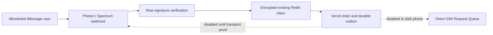

# Air

Air is a private, allowlisted image-and-video studio operated entirely through
iMessage. This revision is a **dark deployment**: it provides the durable,
signed iMessage ingress and Vercel recovery shell, but accepts no paid work,
submits to no provider, and sends no iMessages until the separately approved
canary and real-device gates have passed.

There is no Eve, Zap, chat adapter, or LLM runtime in the Air request path.
When enabled in a later approved release, Air will use the direct GMI Request
Queue boundary; it does not delegate generation to another application.

## Privacy and durability

- Only direct messages from HMAC-hashed allowlisted senders are eligible.
- The sole unauthenticated ingress is `POST /webhooks/imessage`. It checks the
  raw Photon/Spectrum signature before parsing JSON, then encrypts and
  idempotently persists a receipt before returning `200`.
- Prompts, sender identifiers, thread identifiers, attachment references,
  settings, and outbox payloads are encrypted in the existing Redis resource.
  Media bytes are never stored in Redis or logs.
- The release starts with every side-effect switch explicitly `false`. Missing
  switches also fail closed.
- Provider ambiguity and iMessage delivery ambiguity are never retried
  blindly. The bundled Photon transport is deliberately unverified and cannot
  send until the approved real-line transport spike is complete.



## Route surface

| Route | Method | Purpose |
| --- | --- | --- |
| `/` | `GET` | Minimal public Air status. |
| `/healthz` | `GET` | Static health response with no dependency details. |
| `/webhooks/imessage` | `POST` | Signed iMessage receipt ingress. |
| `/internal/drain-inbox` | `GET`, `POST` | `CRON_SECRET` bearer-protected minute recovery route. |
| `/internal/readiness` | `GET` | `CRON_SECRET` bearer-protected, secret-safe readiness report. |

`vercel.json` declares the recovery cron exactly once, every minute, with a
60-second function limit. The operator routes do not reveal configuration
values, raw messages, sender hashes, or provider responses. Readiness probes
only a fixed Redis operational key; it reports coarse Redis and Cron status,
the configured switches, and their effective release-phase-gated state.

## Current deployment state

The committed model registry contains **zero enabled models**. This is
intentional: no GMI catalog, model schema, input-hosting rule, or price quote
has been verified by authenticated evidence. Consequently `/models` is empty
and creation commands cannot reserve spend or call a provider.

The intended existing Vercel project is `air` at `air.wzrd.tech`. A preview may
be deployed only with the explicit dark settings below. Do not promote it,
attach or update an iMessage webhook, create infrastructure, or send a
provider request as part of this dark deployment.

## Configuration

Use [`.env.example`](.env.example) as a names-only template. Production and
preview secrets belong in Vercel, never in Git or logs. The existing Upstash
REST pair is preferred in serverless; `REDIS_URL` is a validated fallback.

For dark deployment, set all four switches explicitly:

```text
AIR_RELEASE_PHASE=dark
AIR_ACCEPT_NEW_JOBS=false
AIR_ALLOW_PROVIDER_SUBMIT=false
AIR_ALLOW_PROVIDER_RECOVERY=false
AIR_DELIVERY_ENABLED=false
AIR_MODEL_REGISTRY_VERSION=2.1.0
```

Keep `GMI_API_KEY` absent for the dark deployment. The key is only relevant
after a separate Fable approval authorizes an authenticated catalog/schema
verification and a limited canary.

## Checks and dark-preview runbook

```sh
npm ci
npm run typecheck
npm test
npm run build
```

See [RUNBOOK.md](RUNBOOK.md) for the exact non-billable preview procedure,
rollback, and the approval gates for provider and iMessage enablement.
