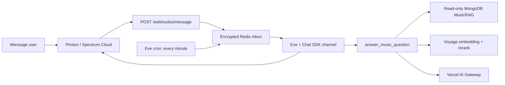

# AR Agent (`air`)

AR Agent is a small, allowlisted iMessage research assistant for A&R and the
music industry. It answers only from the existing read-only `music_rag`
transcript corpus, validates every factual answer's citations, and sends an
iMessage response only after its encrypted durable queue records it.

## What is deliberately in scope

- iMessage direct messages through Photon’s official Chat SDK adapter.
- Photon/Spectrum signed webhooks at `POST /webhooks/imessage`.
- Eve with Redis-backed Chat SDK state and one callable tool:
  `answer_music_question`.
- Hybrid MongoDB Atlas retrieval, Voyage embedding/reranking, and Vercel AI
  Gateway generation using `google/gemini-3.5-flash` at temperature `0.2`.
- Encrypted Redis inbox/outbox, idempotency, per-thread serialization,
  allowlisting, and rate limiting.

The V1 deliberately has no web chat, gateway polling, group-chat RAG,
attachments, outbound campaigns, database writes, Box, or Zap integration.

## Architecture



The public webhook reads the raw request bytes once, limits the body to 64 KiB,
validates the Photon HMAC, normalizes only required fields, encrypts the
envelope, and persists it before returning success. The official adapter is
used for thread IDs and outbound delivery. Its generated receiver remains
pinned at the intentionally unregistered `/_internal/chat-sdk/imessage` path,
where the official adapter verifies HMAC but Air has no dispatching bot
handlers, so a delivery cannot start an Eve session. Photon must be configured
only for `/webhooks/imessage`, which is Air's sole intended dispatch path.

## Local setup

Use Node 24 and npm. Copy placeholders only; do not use production Photon
credentials locally or in a preview environment.

```sh
cp .env.example .env
npm ci
npm run check
npm run build
```

Required production configuration is documented in `.env.example`. The process
fails closed when the production iMessage credentials, Redis URL, encryption
key, sender-hash secret, allowlist, or cron secret is missing. `AIR_ALLOWED_SENDER_HASHES`
contains HMAC hashes, never phone numbers or email handles.

To produce an allowlist entry without printing the original handle, run a
short, local one-off script in a trusted shell that calls
`hashSenderIdentifier(AIR_ID_HASH_SECRET, handle)`; store only the resulting
lowercase 64-character digest in Vercel Production.

## Webhook setup

Configure Photon/Spectrum Cloud to deliver signed `messages` events to:

```text
https://air.wzrd.tech/webhooks/imessage
```

Set the per-webhook signing secret as `IMESSAGE_WEBHOOK_SECRET`. Air accepts
the adapter-compatible signature format: header `X-Spectrum-Signature` is
`v0=<hex>` over `v0:{X-Spectrum-Timestamp}:{raw body}`. Replays share the
same durable record by Photon project ID plus message ID; the webhook delivery
ID remains redacted metadata.

Never configure the Chat SDK adapter route in Photon. The bridge is retained
for Redis-backed state and Photon-backed thread posts; Eve workflow state holds
only an opaque delivery-target HMAC, while the physical thread remains in an
encrypted Redis target until a post is made. Its generated
`GET`/`POST /_internal/chat-sdk/imessage` receiver is a framework-required,
intentionally unregistered HMAC-verification boundary, not an alternate
ingress. The build verification permits exactly that internal route pair and
rejects any additional application dispatch path.

## Behavior and privacy

- Only inbound text DMs up to 2,000 characters can begin research.
- Groups receive at most one DM-only notice per thread per seven days; they
  never start retrieval or generation.
- Non-allowlisted senders receive at most one access notice per seven days.
- Allowed senders are limited to 3 questions/minute and 20/rolling day.
- Sender IDs and thread IDs are HMAC pseudonyms in application Redis keys and
  logs. Message text, transcript snippets, credentials, signatures, and raw
  payloads are never logged.
- Eve workflow titles are fixed and its channel metadata/state contains only
  opaque HMACs; a physical iMessage thread is resolved from encrypted Redis
  only during an outbound Chat SDK post.
- The model cannot use shell, file, browser, web-search, or database-write
  tools. All Eve built-ins are explicitly disabled.

The RAG pipeline retrieves up to 80 hybrid candidates (`vector_index` plus
`text_index`), reranks with `rerank-2.5`, keeps eight ranked chunks, expands
neighbors within an approximately 8,000-token budget, diversifies episodes,
and exposes at most ten sources to citation selection. It rejects URLs in the
model answer, unsupported/unknown markers, uncited factual claims, and more
than four cited sources. Source links are rendered programmatically and only
for HTTPS `youtube.com`, `www.youtube.com`, or `youtu.be` URLs.

## Operator routes

| Route | Method | Purpose |
| --- | --- | --- |
| `/` | `GET` | Minimal public AR Agent status. |
| `/healthz` | `GET` | `{ ok, version }` only; no upstream or secret details. |
| `/webhooks/imessage` | `POST` | Signed, durable iMessage ingress. |
| `/internal/drain-inbox` | `POST` | `CRON_SECRET`-protected recovery drain; returns no queue contents. |

The Eve schedule runs once per minute as recovery only. It is not a Photon
gateway or polling transport.

## Send-unknown operator report

For an ambiguous Photon delivery, inspect the bounded metadata-only report
before making any manual resend decision:

```sh
npm run --silent ops:send-unknown -- --limit 100
```

Run it only in a trusted operator shell with `REDIS_URL` already configured.
It prints JSON Lines containing exactly `correlationId`, `age` (milliseconds
since the record became `send_unknown`), `attempt`, and `errorCategory`; it
never reads or decrypts the encrypted response payload. The limit defaults to
100 and is capped at 500. The report is read-only and does not retry or send
anything.

## Atlas preflight

Air's MongoDB user must be read-only on `music_rag` and limited to the existing
`chunks`, `episodes`, `entities`, and `channels` collections. Before production
deployment, verify:

1. `vector_index` targets `embedding` with 1,024 dimensions.
2. `text_index` covers `text`, `title`, `guests`, and `topics`.
3. Required source metadata exists and returned deep links validate.
4. The Air user cannot insert, update, delete, create indexes, or administer
   the cluster.
5. Atlas network access is limited to an approved Vercel static-egress or
   Secure Compute path—never `0.0.0.0/0`.

## Verification

```sh
npm ci
npm run typecheck
npm test
npm run build
```

`npm run build` runs a manifest regression check: `answer_music_question` must
be the only callable tool, the adapter receiver must remain pinned to its
unregistered internal route, and no alternate Chat SDK iMessage webhook can be
emitted. Test a signed fixture,
duplicate delivery, invalid signature, interrupted post-ack drain, group
notice, allowlist rejection, rate limit, known-corpus answer, and missing
evidence before any production webhook is enabled.

### MusicRAG golden retrieval gate

Air owns the supplied 40-question MusicRAG fixture in
[`eval/musicrag-golden.jsonl`](eval/musicrag-golden.jsonl). Its pure metric
harness is covered by normal unit tests; it does not need MongoDB, Voyage, or
generation credentials. The credential-gated live retrieval run is separate:

```sh
# Trusted operator shell only: read-only Atlas + Voyage credentials required.
npm run eval:golden
```

It runs the actual Air retrieval path sequentially against the existing corpus,
prints only the aggregate Recall@10, MRR@10, and nDCG@10 summary, and fails if
the three-decimal recorded MusicRAG agent baseline is not met. It does not
generate answers, send messages, write Atlas data, or claim a result until the
command is executed. See [`eval/README.md`](eval/README.md) for fixture
provenance and credential requirements.

## Deployment and rollback

1. Create the private `gratitude5dee/air` repository and push only this app.
2. Create Vercel project `air` in the 5-Dee Studios team; pin Node 24.
3. Deploy preview using fixture credentials and a separate read-only Atlas
   identity. Do not put production Photon credentials in preview.
4. Set Production secrets, confirm Vercel is `READY`, then attach
   `air.wzrd.tech` and configure the Photon webhook.
5. Run one allowlisted real-device canary before opening the beta.

Rollback: disable the Photon webhook, allow started sessions to settle,
preserve only redacted delivery metadata, promote the previous READY Vercel
deployment with compatible secrets, re-enable the webhook, then run the
allowlisted canary. Never automatically replay a `send_unknown` record;
inspect its correlation ID, age, attempt, and error category before deciding
whether to resend.

## Monitoring and alert handoff

Before enabling the production Photon webhook, configure a Vercel log drain or
observability alert destination owned by the 5-Dee Studios team. Alert on
`imessage.dead_letter`, `imessage.response_send_unknown`, sustained
`imessage.webhook_rejected`, `imessage.webhook_unavailable`, inbox age over two
minutes, and Atlas, Voyage, or AI Gateway failures. Include only the redacted
correlation ID, queue age, retry count, and error class in alert payloads.

Exercise that path with a synthetic non-PII failure during rollout, record the
receiving on-call destination, and verify that no raw sender identifier or
message content appears in Vercel logs or alerts.

## Secret rotation

Rotate Photon project/webhook credentials, the Atlas read-only user, Redis URL,
Voyage key, queue-encryption key, identity-hash secret, and cron secret through
Vercel Production. Use an overlap window whenever the upstream supports it;
otherwise disable the Photon webhook first, rotate, deploy, verify signed
fixtures, and re-enable it.
