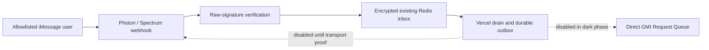

# Air

Air is a private, allowlisted image-and-video studio operated entirely through
iMessage. The source supports a narrowly scoped **delivery-only iMessage
smoke release**: allowlisted users can receive bounded text help/status
responses, while all image/video generation and every provider action remain
disabled. The currently promoted production alias is still the legacy build
until this direct-studio release is deployed and verified.

There is no Eve, Zap, chat adapter, or LLM runtime in the Air request path.
When enabled in a later approved release, Air will use the direct GMI Request
Queue boundary; it does not delegate generation to another application.

## Privacy and durability

- Only direct messages from HMAC-hashed allowlisted senders are eligible.
- The sole unauthenticated ingress is `POST /webhooks/imessage`. It checks the
  raw Photon/Spectrum signature before parsing JSON, then encrypts and
  idempotently persists a receipt before returning `200`.
- Prompts, sender identifiers, thread identifiers, attachment references,
  settings, and outbox payloads are encrypted in the existing Redis resource.
  Media bytes are never stored in Redis or logs.
- Once an inbox receipt reaches a terminal state, its encrypted prompt,
  attachment, and thread envelope is atomically erased; only pseudonymous
  receipt metadata remains for bounded idempotency/audit retention.
- Job admission metadata likewise remains recoverable without expiry while
  nonterminal, but its encrypted prompt/input/thread snapshot is a separate,
  immutable 24-hour record. A future executor must terminalize an expired
  snapshot as a known privacy failure rather than reconstructing it.
- Pending media is encrypted for an absolute maximum of ten minutes. Each
  project/sender/chat/line scope has a durable opaque receipt sequence, so a
  retry cannot overwrite a newer pending item, revive a cancellation, or
  extend that retention window. Media-first corrections are durable `dueAt`
  entries delayed 500 ms rather than an open-function debounce.
- The release starts with every side-effect switch explicitly `false`. Missing
  switches also fail closed.
- Provider ambiguity and iMessage delivery ambiguity are never retried
  blindly. The direct Photon transport supplies the durable outbox ID as the
  provider `clientMessageId`, disables client retry, and turns a failed send
  RPC into `send_unknown` for reconciliation rather than replaying it.
- Direct transport is text-only. Attachment upload/fetch, tapbacks, reply
  dispatch, media generation, provider submission, provider polling, and
  provider recovery all remain disabled.



## Route surface

| Route | Method | Purpose |
| --- | --- | --- |
| `/` | `GET` | Minimal public Air status. |
| `/healthz` | `GET` | Static health response with no dependency details. |
| `/webhooks/imessage` | `POST` | Signed iMessage receipt ingress. |
| `/internal/drain-inbox` | `GET`, `POST` | `CRON_SECRET` bearer-protected minute recovery route. |
| `/internal/readiness` | `GET` | `CRON_SECRET` bearer-protected, secret-safe readiness report. |
| `/internal/release-fence` | `POST` | `AIR_RELEASE_FENCE_SECRET` bearer-protected release-generation CAS. |

`vercel.json` declares the recovery cron exactly once, every minute, with a
60-second function limit. The operator routes do not reveal configuration
values, raw messages, sender hashes, or provider responses. Readiness probes
only a fixed Redis operational key; it reports coarse Redis and Cron status,
the configured switches, and their effective release-phase-gated state.

## Current deployment state

The committed model registry contains **zero enabled models**. This is
intentional: no GMI catalog, model schema, input-hosting rule, or price quote
has been verified by authenticated evidence. Consequently `/models` is empty
and creation commands cannot reserve spend or call a provider.

The intended existing Vercel project is `air` at `air.wzrd.tech`. A build-only
preview with no protected configuration defaults to the dark, all-false policy
and can verify only the public shell. The production smoke release may enable
only `AIR_DELIVERY_ENABLED`; it must leave every provider and paid-generation
switch false, keep the registry at zero enabled models, and never set a GMI
credential as part of this rollout.

## Configuration

Use [`.env.example`](.env.example) as a names-only template. Production and
preview secrets belong in Vercel, never in Git or logs. The existing Upstash
REST pair is preferred in serverless; `REDIS_URL` is a validated fallback.

For a protected dark deployment, set every side-effect switch explicitly:

```text
AIR_RELEASE_PHASE=dark
AIR_RELEASE_GENERATION=0
AIR_ACCEPT_NEW_JOBS=false
AIR_ALLOW_PROVIDER_SUBMIT=false
AIR_ALLOW_PROVIDER_RECOVERY=false
AIR_DELIVERY_ENABLED=false
AIR_MODEL_REGISTRY_VERSION=2.1.0
```

Keep `GMI_API_KEY` absent for the dark deployment. The key is only relevant
after a separate Fable approval authorizes an authenticated catalog/schema
verification and a limited canary.

For the approved delivery-only smoke release, use a positive production
generation and an independent `AIR_RELEASE_FENCE_SECRET`, keep all three
provider/job switches `false`, set `AIR_DELIVERY_ENABLED=true`, and retain all
spend caps at zero. The full procedure is in [RUNBOOK.md](RUNBOOK.md).

## Release fence

Every Studio outbox intent carries the deployment's `{ generation, phase }`.
An authenticated operator must explicitly create or advance the shared Redis
fence using `POST /internal/release-fence` and a literal `If-Match` generation;
deploying code or running Cron never arms it. The first record is dark
generation `0` with `If-Match: -1`; later deployments advance exactly one
generation at a time. The endpoint returns no state details and is not part of
this dark preview procedure.

At outbox publication, a nonmatching generation is refused. At claim and
immediately before physical dispatch, an already-persisted stale record is
canceled without delivery. A missing or corrupt active fence pauses safely
before dispatch. This protects generic onboarding, help, status, maintenance,
and pending-assembly messages alike.
It cannot revoke a transport call already authorized by an older worker, so a
future real-line rollback drill must reconcile any such `send_unknown` record.

The codebase now contains a fake-backed, **unprovisioned** provider-submission
foundation. It persists an encrypted admission snapshot and a durable
submission intent before an injected provider port could be called; an
ambiguous outcome becomes `submission_unknown` and is never replayed. The
deployed runtime supplies an unverified provider port and does not invoke this
executor from ingress or Cron, so it does not make a provider path live.

The store also contains dark-only, fake-tested reconciliation primitives. They
compare exact record versions, record only opaque actor/audit metadata, and
never call a provider or transport. A verified provider request ID can be
attached to an ambiguous subrun; an ambiguous iMessage send can be confirmed
or requeued exactly once as a new delivery attempt. Requeue preserves the
original lane and payload's remaining 24-hour TTL; an expired payload becomes
the terminal `artifact_expired` state rather than being refetched or resent.
No reconciliation HTTP endpoint is exposed in the dark preview.

Provider catalog/schema evidence, price authority, media upload/download,
polling, output delivery, real transport proof, and a bounded rollback drill
remain mandatory canary gates. The outbox and pre-submit fences are not an
activation approval.

## Checks and dark-preview runbook

```sh
npm ci
npm run typecheck
npm test
npm run build
```

See [RUNBOOK.md](RUNBOOK.md) for the exact non-billable preview procedure,
rollback, and the approval gates for provider and iMessage enablement.
