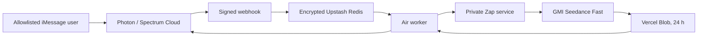

# Air

Air is a private, allowlisted iMessage video generator. A user sends a text
prompt and may attach one image; Air submits a fixed Seedance Fast request
through Zap and returns the resulting MP4 in the same iMessage thread.

Air no longer uses MongoDB, Atlas, Voyage, retrieval, citations, or an AI
Gateway generation path. Zap owns GMI credentials, provider polling, spend
limits, and short-lived video storage.

## Request contract

- Direct messages from an allowlisted sender only.
- Text prompt: 1–2,000 characters.
- Optional single JPEG, PNG, HEIC, or HEIF attachment, at most 10 MB.
- HEIC/HEIF is converted to JPEG before upload.
- One active generation per sender; max three accepted requests per rolling
  24 hours.
- The fixed Zap request is Seedance `seedance-2-0-fast-260128`, five seconds,
  720p, adaptive ratio, generated audio, no watermark or web search.

Unsupported input is rejected before a paid request. Air never stores media
bytes in Redis. Prompts, attachment references, Zap IDs, and signed URLs are
encrypted at rest and are never written to application logs or Redis metadata.
Do not set an `OTEL_EXPORTER_OTLP_*` environment variable for Air: Spectrum
telemetry requires a dedicated redacting pipeline before it can be exported.

## Architecture



The webhook verifies the raw Photon signature and persists an encrypted,
idempotent inbox record before it returns `200`. A post-ack worker and a
minute recovery cron share the same ordered queue. Paid submission is first
recorded as `submission_unknown`; an ambiguous provider result is never
automatically resubmitted. A durable `sending` intent and an ambiguous
iMessage delivery are operator-visible and never blindly sent again. Once a
video job is durable, the inbox reaches terminal `handed_off` and cannot replay
the request.

## Air environment

Set these in Vercel Production only (names, never values, are listed here):

- `IMESSAGE_PROJECT_ID`, `IMESSAGE_PROJECT_SECRET`,
  `IMESSAGE_WEBHOOK_SECRET`
- `REDIS_URL`
- `ZAP_AIR_SERVICE_URL`, `ZAP_AIR_SERVICE_TOKEN`
- `AIR_ID_HASH_SECRET`, `AIR_QUEUE_ENCRYPTION_KEY`,
  `AIR_ALLOWED_SENDER_HASHES`
- `AIR_PUBLIC_BASE_URL`, `CRON_SECRET`

Use [`.env.example`](.env.example) for local placeholders. Air fails closed in
production unless every required value and at least one sender hash exist.
Generate an allowlist value locally with `hashSenderIdentifier` and store only
the resulting lowercase 64-character HMAC digest.

Zap Production additionally requires its existing Redis/Convex runtime plus:

- `GMI_API_KEY`, `GMI_SEEDANCE_FAST_USD_PER_SECOND`
- `BLOB_READ_WRITE_TOKEN`
- `ZAP_AIR_SERVICE_TOKEN`, `ZAP_AIR_IDEMPOTENCY_HMAC_SECRET`,
  `ZAP_AIR_UPLOAD_TICKET_ENCRYPTION_KEY`
- `ZAP_AIR_DAILY_CAP_USD`, `ZAP_AIR_MAX_RUN_USD`

Zap refuses generation until it has a verified current Seedance Fast rate and
both cost caps. Air never receives the GMI API key.

## Routes

| Route | Method | Purpose |
| --- | --- | --- |
| `/` | `GET` | Minimal public Air status. |
| `/healthz` | `GET` | Static health response; no dependency or secret details. |
| `/webhooks/imessage` | `POST` | Photon/Spectrum signed ingress. |
| `/internal/drain-inbox` | `POST` | `CRON_SECRET`-bearer protected recovery trigger. |

The Photon webhook must point only at:

```text
https://air.wzrd.tech/webhooks/imessage
```

Do not configure that webhook until Zap and Air have a ready production
deployment and the signed fixture has passed. Air uses the Spectrum Cloud
webhook format; it is not compatible with the Photon Advanced Wire endpoint.

## Local checks

```sh
npm ci
npm run typecheck
npm test
npm run build
```

`npm run build` verifies that the compiled Eve app exposes only Air's three
HTTP routes, its one recovery schedule, and no model tools. Eve is retained
only as the route/cron host; Air does not start an Eve model session.

## Deployment sequence

1. Push the Air and Zap branches to their GitHub repositories.
2. Deploy Zap preview with fixture-only values; verify private upload, run,
   poll, Blob, and cleanup behavior.
3. Set Zap Production values, deploy it, and verify `zap.wzrd.tech`.
4. Set Air Production values, deploy it, attach `air.wzrd.tech`, and verify
   `/healthz` plus a signed webhook fixture.
5. Add the Photon/Spectrum webhook last, then run the allowlisted real-device
   text-to-video and image-to-video acceptance tests.

For an uncertain delivery, run the read-only metadata report in a trusted
operator shell:

```sh
npm run --silent ops:send-unknown -- --limit 100
```

It reports `submission_unknown`, `sending`, and `send_unknown` records. They
must be investigated manually; the report does not decrypt payloads, retry, or
send messages.
