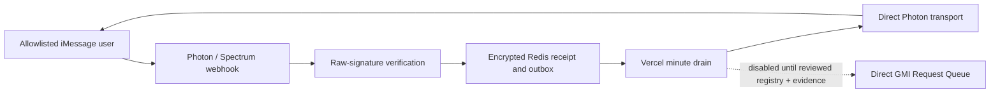

# Air

Air is a private, allowlisted image-and-video studio operated entirely through
iMessage. Its direct Vercel runtime is the source of truth; it does not route
new work through Zap, Eve, a chat adapter, or an LLM runtime. Zap remains
available only to drain or roll back jobs that were accepted by an older
deployment.

## Live status

The public direct-runtime alias is [`https://air.wzrd.tech`](https://air.wzrd.tech)
from `codex/air-direct-studio`. Its public health endpoint returns
`{"ok":true,"version":"2"}`. Record the exact deployment ID only with its
promotion handoff; do not carry a stale ID forward in this document.

The public webhook is deliberately **receipt-only**. After it verifies the raw
signature and durably stores a receipt, it returns promptly. It does not drain
queues, send through Photon, fetch media, or call a provider. The once-per-
minute Vercel drain is the only scheduled worker that may claim that stored
work.

This is **not** a paid-generation activation:

- The committed `2.1.0` model registry has zero enabled models and no mode
  defaults. `/imagine`, `/animate`, `/edit-image`, and `/edit-video` cannot
  reserve spend or call a provider.
- `GMI_API_KEY` is present as an encrypted, server-only Vercel environment
  variable by name for Preview and Production. A protected production process
  check received it as an empty value; no secret value was printed or retained.
  Treat the credential as unavailable until its owner corrects it directly in
  Vercel. A key by itself cannot provision the runtime: provider composition
  also requires one exactly reviewed, enabled registry entry.
- The already-approved shared `$100` ceiling remains a background hard safety
  control. It is not a user-confirmation step and it is not a model approval.
- The documented Flux result example combines `is_public: false` with a bare
  storage URL. That is not a private or signed retrieval contract, so it is
  insufficient for Air and no GMI model is armed.
- This release rejects bare, malformed, or cross-model provider results before
  any artifact fetch and prevents an attachment from leaving after a failed
  result preamble on a restarted worker.
- The direct Photon webhook configuration and an owner-originated allowlisted
  `/help` reply have not yet been observed on this deployment. Text delivery
  is therefore deployed but not yet accepted as a handset smoke result.

## Photon credential boundary and incident

`IMESSAGE_WEBHOOK_SECRET` is the inbound raw-HMAC signing secret for
`POST /webhooks/imessage`. `IMESSAGE_PROJECT_SECRET` is a distinct outbound
Photon project API credential that is used only when Air prepares delivery.
They are not interchangeable, and neither is needed in chat or source control.

A Photon CLI response unexpectedly exposed the outbound project credential in
local tool output. Treat that credential as compromised. Do not paste it,
retrieve it again, or rotate it as a routine smoke-test step. A replacement
requires the owner's explicit authorization and a coordinated operation that
rotates the **outbound** credential, updates every intended encrypted Vercel
environment target, redeploys, and only then runs the signed handset `/help`
test. The inbound webhook HMAC secret must remain separate and unchanged
unless its own incident requires rotation.

## Privacy and ingress guarantees

- Only direct messages from HMAC-hashed allowlisted senders are eligible.
- `POST /webhooks/imessage` is the sole unauthenticated ingress. It verifies
  the raw Photon/Spectrum signature before JSON parsing, then encrypts and
  idempotently persists the receipt before returning `200`; it never performs
  queue draining or a physical provider/Photon action in that request.
- The minute drain at `/internal/drain-inbox`, not the webhook handler, is the
  only scheduled worker for inbox, job, and outbox progress.
- Prompts, sender/thread identifiers, attachment references, settings, and
  outbox payloads are encrypted in Redis. Media bytes, API keys, raw provider
  replies, provider URLs, and raw iMessage content are not logged.
- Terminal inbox records erase their encrypted prompt, attachment, and thread
  envelope; only bounded pseudonymous idempotency/audit metadata remains.
- Pending media is encrypted for at most ten minutes. Admission snapshots and
  outbox payloads have independent, bounded retention and cannot be extended
  by a retry.
- Every outbound intent is stamped with the shared release generation. A stale
  or missing fence cancels or pauses delivery before transport dispatch.



## Route surface

| Route | Method | Purpose |
| --- | --- | --- |
| `/` | `GET` | Minimal public Air status. |
| `/healthz` | `GET` | Static health response with no dependency details. |
| `/webhooks/imessage` | `POST` | Signed iMessage receipt ingress. |
| `/internal/drain-inbox` | `GET`, `POST` | `CRON_SECRET` bearer-protected minute recovery route. |
| `/internal/provider-audit` | `GET` | Manually invoked, `CRON_SECRET` bearer-protected, read-only GMI contract review. |
| `/internal/readiness` | `GET` | `CRON_SECRET` bearer-protected, secret-safe readiness report. |
| `/internal/release-fence` | `GET`, `POST` | `AIR_RELEASE_FENCE_SECRET` bearer-protected epoch read and release-generation CAS. |

`vercel.json` declares exactly one Cron: `/internal/drain-inbox` every minute,
with a 60-second function limit. The provider-audit route is intentionally not
a Cron and is never reachable without its bearer check.

## Safe server-only GMI audit

`GET /internal/provider-audit` is designed to be the only live use of a usable
GMI credential in the current release. The names-only Vercel inventory and an
empty protected process value do not establish a usable key, so this audit is
not current provider-readiness evidence. Its implementation is deliberately
narrow:

- It accepts only `GET` with the existing `CRON_SECRET` bearer credential.
- It makes only the fixed, read-only catalog and exact-model-detail requests
  for `flux-kontext-pro`.
- It cannot submit, poll, cancel, upload, fetch an artifact, enable a model,
  or modify the registry or release fence.
- Its response contains a fixed model ID, availability, minimized parameter
  names/types/requiredness, and deterministic evidence fingerprints. It does
  not return raw GMI payloads, API keys, prompts, request IDs, result URLs, or
  prices. `pricing: "manual_console_required"` is expected.

An operator may invoke it from a terminal where they already hold the secret;
never paste `CRON_SECRET` into chat, source, a URL, or logs:

```sh
curl --fail-with-body -sS \
  -H "Authorization: Bearer ${CRON_SECRET}" \
  https://air.wzrd.tech/internal/provider-audit
```

A `401` or `503` is a stop condition, not a reason to expose a secret or
broaden the endpoint. In particular, a `503` can reflect the currently empty
GMI credential. A successful audit is evidence for review only; it does not
activate `/imagine`.

## Dormant direct provider-result delivery path

The direct result lifecycle is implemented and tested, but it remains dormant
until the registry and release gates are satisfied. When a model is reviewed
and enabled, it protects the post-submit path as follows:

1. It observes only a durably known provider request; an ambiguous submission
   is terminalized for reconciliation rather than resubmitted.
2. It permits result retrieval only through the registry's exact reviewed
   host/path prefix and private or signed access contract. The registry must
   assert `publiclyAccessible: false`; a signed result currently requires a
   complete GCS V4 signed-query envelope, while a `provider-private` result
   needs a dedicated authenticated retriever rather than a generic HTTP GET.
3. A validated result is prepared as one native Photon attachment. An expired
   or ambiguous upload becomes `upload_unknown` and
   `reconciliation_required`; Air does not refetch the provider result or
   repeat the Photon upload.
4. One atomic finalizer persists the text preamble, the attachment intent,
   the delivery cursor, the successful observation, and `executing → ready`.
   Dispatch enforces preamble-before-attachment ordering.
5. A transport ambiguity becomes `send_unknown` for reconciliation, never an
   automatic physical resend. A release-fence mismatch blocks stale outbox
   delivery before dispatch.

The minute Vercel Cron has a bounded execution budget. Until Air has a
durable encrypted provider-result reference split and a reviewed timing proof,
that worker deliberately does **not** begin an `executing` provider-result
recovery (provider observation, artifact retrieval, and Photon upload). It
may still reconcile already prepared `ready` and `delivering` state. This is a
fail-closed `/imagine` activation gate, not an automatic retry delay.

These safeguards do not establish that a provider model is approved, private,
priced, or live. They are failure boundaries for a later reviewed release.

## Conditions to activate `/imagine`

`/imagine` is the first proposed paid mode. It remains disabled until all of
the following are recorded and deployed together:

1. A secret-safe production check confirms that the owner has supplied a
   nonempty `GMI_API_KEY` directly in Vercel. A configured variable name, or
   the prior empty-value check, fails this gate.
2. The protected audit confirms exact `flux-kontext-pro` availability and its
   request schema, producing reviewable catalog and schema fingerprints.
3. An operator reviews the account-specific GMI Console/Model Hub price and
   records an exact bounded quote; public documentation is not price
   authority.
4. The output contract is proven private/signed for this exact model, including
   its exact result host and non-root path prefix. Generic provider examples
   are not sufficient. In particular, a bare storage URL is not evidence of
   private access even when a provider labels the response `is_public: false`.
   GMI's [Flux quickstart](https://docs.gmicloud.ai/model-quickstarts/image/flux-kontext-pro)
   currently demonstrates that exact ambiguity, so it establishes the model
   identifier—not Air's private-delivery contract.
5. A reviewed committed registry entry pins the adapter, request/result schema
   fingerprints, input policy, output policy, price quote, polling bounds, and
   one-image contract. The release must then pass typecheck, tests, and the
   Vercel build verifier.
6. A durable encrypted provider-result reference split (or a reviewed proof
   that the full observe/retrieve/validate/upload/finalize chain fits the
   bounded worker deadline) is deployed. The current bounded Cron intentionally
   defers that `executing` recovery path.
7. The exposed outbound Photon credential has been replaced through the
   explicitly authorized coordinated rotation, and the direct webhook plus
   allowlisted handset `/help` smoke have passed.
8. A separately reviewed release advances the shared release fence and keeps
   the existing `$100` hard ceiling in force. Flags alone can never enable
   spend.

`/animate`, `/edit-image`, and `/edit-video` remain disabled after an
`/imagine` activation until each has its own exact model, media, price, and
private-output evidence. Air must not use a GMI upload flow that returns a
documented publicly accessible input URL for allowlisted user media; those
modes require a separately verified private input-object contract.

## Configuration and release fence

Use [`.env.example`](.env.example) as a names-only dark-development template;
it intentionally leaves `GMI_API_KEY` absent. Production secrets belong in
Vercel and must be checked by name/status only, never pulled into a local file
or printed. In particular, `GMI_API_KEY`, Photon credentials, Redis tokens,
allowlist hashes, `CRON_SECRET`, and `AIR_RELEASE_FENCE_SECRET` stay
server-only.

Keep the two Photon credentials distinct: `IMESSAGE_WEBHOOK_SECRET` verifies
inbound raw-HMAC webhooks, while `IMESSAGE_PROJECT_SECRET` authorizes lazy
outbound delivery. Because the latter was exposed by a CLI response, do not
use it for a live `/help` test. Wait for explicit owner authorization for the
coordinated rotation and Vercel update described above; never ask an operator
to paste either secret into chat.

Paid provider work requires all of the following at runtime: an active release
phase, explicit admission/submit policy, explicit positive per-job and daily
caps, a matching release fence, and a verified provider composed from the
committed registry. Provider recovery has its own explicit policy so a
rollback can stop new work without guessing about an already known request.

The fence is advanced only through authenticated compare-and-swap. Deploying
code or allowing the minute Cron to run does not arm a release. At publication,
claim, and dispatch, a nonmatching generation is blocked; the fence cannot
undo a transport call already authorized by an older worker, so that edge
remains a reconciliation event.

## Checks

```sh
npm ci
npm run typecheck
npm test
npm run verify:build
npm run build
```

See [RUNBOOK.md](RUNBOOK.md) for the current deployment handoff, protected
audit procedure, handset smoke test, activation gates, and rollback behavior.
